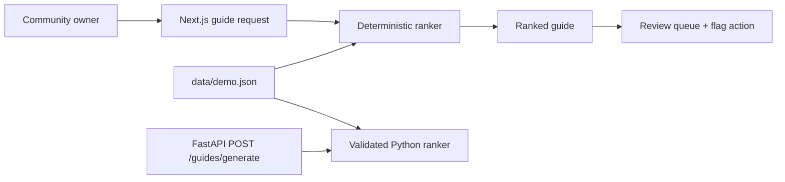

# Architecture

GitHub Pages computes locally with fictional fixtures. FastAPI implements the same domain operation but is tested source only and is not deployed.

`POST /guides/generate` accepts a known community ID, supported use case, budget from $100–$20,000, and review age from 30–730 days. It returns ranked picks, transparent score components, freshness/dissent states, a maintenance queue, and rule version. Unknown communities and unsupported use cases return named 404/422 errors.

Shadow paths: nil/wrong types → 422; zero/negative budget → 422; no eligible products → explicit empty result; stale evidence → visible warning and review queue; calculation error → inline alert; slow UI action → disabled submit; changed input → stale output is cleared. Production adds tenant isolation, immutable editorial revisions, rate limits, connector kill switches, structured logs, stale-guide metrics, and a runbook.
